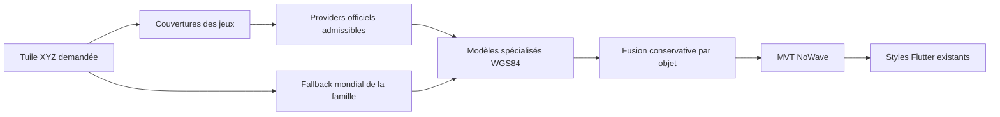

# Données marines multi-sources NoWave

Catalogue vérifié le 16 octobre 2026 ; code et contrôle final le 17 octobre 2026. Données d'affichage transformées par NoWave,
**non utilisables pour la navigation**. Ce travail ne déploie pas le backend distant.

## Flux et sélection

`MarineTileService` reçoit exclusivement `Tile(z,x,y)` et `MarineFamily`.
Aucun paramètre GPS, utilisateur ou pays du téléphone n'intervient.
Les providers implémentent le protocole `MarineProvider`: `covers` puis `fetch`.
SHOM et IGN couvrent des familles différentes. NOAA possède des classes distinctes
par famille et échelle. Ajouter un fournisseur n'exige aucune modification Flutter.

Le routage utilise des masques vectoriels embarqués, pas un pays déduit du centre
de la caméra. NOAA: union des véritables `Coverage_area` aux six échelles, avec
pagination intégrale (26/103/371/1319/4486/65 objets au relevé). SHOM: ZEE et mers
territoriales métropole/outre-mer, trous terrestres comblés et marge de 0,25° pour
les eaux intérieures derrière les lignes de base. Ces masques sont **des indices de
routage conservateurs**, pas des frontières légales ni une garantie d'exhaustivité.
Une requête peut sélectionner plusieurs providers; chacun ne renvoie que ses objets.
Les emprises NOAA débordent parfois la frontière nationale (exemple Vancouver).
IGN utilise des enveloppes conservatrices de ses territoires de produit,
indépendantes des eaux SHOM (y compris les ports intérieurs); pas de couverture
IGN annoncée en Nouvelle-Calédonie/Polynésie/Wallis-et-Futuna.

Les fallbacks sont toujours interrogés et ne sont jamais supprimés par un masque.
Une imprécision de routage peut ajouter une requête, jamais effacer tout OSM.
Les catalogues se rafraîchissent explicitement avec
`backend/tools/refresh_marine_catalog.py --output <répertoire>`; examiner le résultat
et les licences avant de remplacer les fichiers embarqués. Aucun téléchargement
cartographique mondial ni tâche de préchargement OSM n'est créé.

## Matrice des jeux et décisions

| Autorité / pays | Jeu et famille | Accès vectoriel / formats | Couverture, actualisation | Licence et redistribution | État NoWave |
|---|---|---|---|---|---|
| SHOM / France | [Balisage maritime](https://diffusion.shom.fr/donnees/balisage_maritime.html), aides | WFS ouvert; téléchargements SHP, GML, GPKG | ZEE française métropole/outre-mer; actualisation régulière, aucune date de révision par objet publiée dans le flux testé | Licence Ouverte 2.0; copie, adaptation, cache et redistribution y compris tuiles autorisés avec source/date lorsqu'elle existe | **Intégré**, bouées, balises fixes réellement publiées, feux et tours qualifiées comme phares ; topmarks et liens de feux associés |
| SHOM / France | [Informations portuaires](https://diffusion.shom.fr/donnees/informations-portuaires.html), ports | WFS/SHP accessibles | Métropole/outre-mer; page produit: juin 2021 | Licence Ouverte 2.0; attribution « Shom, 2021. Informations portuaires » | **Non intégré**: BERTHS est un poste d'amarrage, HRBARE une zone administrative, FLODOC un dock de mise à sec; aucun n'est une géométrie générique de quai/digue à substituer aux styles actuels |
| IGN / France | [BD TOPO](https://www.data.gouv.fr/datasets/bd-topo-r), `construction_lineaire`, nature=Quai, ports | [WFS 2.0](https://cartes.gouv.fr/aide/fr/guides-utilisateur/utiliser-les-services-de-la-geoplateforme/diffusion/wfs/), GeoJSON 3D; extraction 2D explicite | Métropole, DROM, SPM, St-Martin/St-Barthélemy; flux observé: **2026-06-15**; ne pas confondre les autres éditions/BD TOPO Express avec ce flux | Licence Ouverte 2.0, attribution IGN + jeu + édition; transformation/cache/redistribution permis | **Intégré**, uniquement ouvrages en service, sous-types conservés |
| NOAA / USA | [ENC Direct to GIS](https://nauticalcharts.noaa.gov/data/gis-data-and-services.html), aides | ArcGIS REST query, GeoJSON; classes réelles du catalogue embarqué | Emprises ENC, territoires compris; service déclare une mise à jour hebdomadaire; données de base ENC, pas une garantie de correction nautique instantanée | [ENC CC0 1.0](https://repository.library.noaa.gov/view/noaa/71555), redistribution et dérivés libres, crédit NOAA conservé | **Intégré**, bouées, balises du catalogue vérifié, feux et phares qualifiés ; topmarks/feux joints uniquement à colocalisation exacte dans la même cellule |
| NOAA / USA | Même service, ports | SLCONS point/ligne/surface et DOCARE existent; NoWave utilise lignes/surfaces SLCONS et DOCARE | Six gammes overview/general/coastal/approach/harbour/berthing; les classes absentes à une échelle ne sont pas inventées | Même jeu CC0 | **Intégré**, mapping S-57 vérifié, fusion entre échelles |
| CHS / Canada | [ENC Maritime Chart Service](https://open.canada.ca/data/en/dataset/12b769c8-48b8-4562-80fb-4a2e5ee9b45b), aides | WMS et SOE ArcGIS accessibles; couches symboliques 6/1; les URLs de query vectoriel testées renvoient `Invalid URL` | Atlantique/Pacifique/Arctique/Grands Lacs selon ENC; catalogue: hebdomadaire | **Ce service** est catalogué OGL Canada. Cela n'ouvre pas les fichiers ENC vendus séparément | **Non intégré**, pas d'extraction exhaustive vectorielle validée |
| CHS / Canada | Même service, ports | Couche d'affichage 1, mêmes limites techniques | Idem | Idem pour le service; [ENC / produits dérivés](https://charts.gc.ca/copyright-droitdauteur/index-eng.html) nécessitent leurs propres accords | **Non intégré**, OSM conservé; aucun faux adapter |
| AMSA / Australie | [AMSA Aids to Navigation 2025](https://www.operations.amsa.gov.au/spatial/DataServices/DigitalData), aides | Archive vectorielle annoncée 333,2 Ko; téléchargement soumis aux conditions Spatial@AMSA | Réseau AMSA, pas tous les balisages locaux australiens; édition 2025 | [Spatial@AMSA: CC BY-NC 3.0 AU](https://www.operations.amsa.gov.au/spatial/DataServices/Copyright); restriction non commerciale, attribution © AMSA 2013 | **Non intégré**, pas d'autorisation commerciale/redistribution NoWave suffisamment établie |
| AMSA / Australie | Réseau AtoN, ports | Ce jeu décrit des aides, pas les empreintes de quais/digues | Aucune complétude portuaire établie | La licence du jeu AtoN ne crée aucun accès à des ouvrages portuaires | **Non intégré**, OSM |
| AHO / Australie | AusENC / collection hydrographique, aides | ENC sous licence, ne pas confondre affichage gratuit et accès aux objets | Couvertures publiées AHO, mises à jour selon produit | [Licensing](https://www.hydro.gov.au/hydrography/licensing), [Copyright](https://www.hydro.gov.au/copyright): dérivés soumis à autorisation et termes de l'accord | **Non intégré**, accord absent |
| AHO / Australie | Même collection, ports | Les ENC peuvent contenir les ouvrages, aucun flux libre de redistribution vérifié ici | Selon produit | Idem, pas d'accord obtenu | **Non intégré**, OSM |
| LINZ / NZ | Hydrographic LDS, aides | WFS/export vectoriel existent, [clé API nécessaire](https://www.linz.govt.nz/guidance/data-service/linz-data-service-guide/web-services); requête sans clé: HTTP 400 | Selon couche/échelle, pas de complétude déduite du catalogue général | Licence à vérifier **par couche**; aucune donnée de cette famille n'est redistribuée par NoWave ici | **Non intégré**, aucune clé configurée disponible lors de la validation |
| LINZ / NZ | [Shoreline construction polygon 50611](https://data.linz.govt.nz/layer/50611-shoreline-construction-polygon-hydro-122k-190k/), ports | Polygones SLCONS WGS84, WFS/export via LDS | 1:22k–1:90k, 36 objets; page consultée: 13 avril 2023 | Cette couche spécifiquement: CC BY 4.0; transformation/cache/tuiles permis avec crédit, modifications signalées | **Non intégré**, clé absente; ne pas généraliser cette licence aux autres couches LINZ |
| Open Waters / monde | [Seamap](https://github.com/openwatersio/seamap), aides | XYZ MVT `seamark`, z0–14 | Compilation OSM mondiale, régénérations annoncées hebdomadaires; instantané réellement consulté enregistré dans les preuves | Tuiles CC BY 4.0 + attribution OSM/ODbL; le code GPL et les autres illustrations du projet ne sont pas incorporés | **Intégré**, fallback permanent bouées/balises/feux présents ; un feu majeur ne devient pas un phare |
| OSM / monde | [Shortbread vector tiles](https://operations.osmfoundation.org/policies/vector/), ports | XYZ MVT `water_polygons`, `pier_lines`, `pier_polygons`, z0–14 | Mondial, disponibilité sans SLA; date de mise à jour par objet non fournie | ODbL; attribution et partage de la base dérivée. Politique serveur distincte: cache ≥7 jours, User-Agent joignable, aucun bulk/offline préchargé | **Intégré**, fallback permanent |

Les masques de routage SHOM dérivent du jeu séparé
[Espaces maritimes de souveraineté ou de juridiction](https://www.data.gouv.fr/datasets/espaces-maritimes-de-souverainete-ou-de-juridiction),
Licence Ouverte 2.0, attribution Shom. Le produit original exclut les eaux intérieures;
la marge et le remplissage ne représentent aucune frontière officielle.
Les masques NOAA dérivent de `enc_coverage` sous le même régime ENC CC0.

Les licences ouvertes ci-dessus permettent la copie en cache, l'adaptation et la
redistribution dans une tuile NoWave avec leurs obligations respectives. La base
fusionnée contenant OSM est distribuée sous ODbL; les crédits et licences des apports
SHOM/IGN/NOAA/Open Waters restent attachés. Les endpoints publics donnent accès aux
tuiles dérivées; aucune restriction supplémentaire sur les droits OSM n'est ajoutée.
Les métadonnées de provenance ne remplacent pas les crédits visibles Mapbox.

Les limites de débit SHOM/NOAA/Open Waters ne sont pas chiffrées dans les documents
consultés: ne pas annoncer un quota illimité. Géoplateforme publie
[30 requêtes/s par IP](https://cartes.gouv.fr/aide/fr/guides-utilisateur/utiliser-les-services-de-la-geoplateforme/limites-d-usage/).
LDS requiert une clé; aucun quota non vérifié n'est attribué à son WFS. Les services
CHS/AHO/AMSA non intégrés ne sont pas appelés par la carte.

## Modèles et mapping

`SeamarkFeature` et `PortInfrastructureFeature` sont des dataclasses spécialisées.
Les géométries sources restent en WGS84 longitude/latitude. Les bouées sont des
points; ports: Point, LineString, MultiLineString, Polygon, MultiPolygon. Les
coordonnées IGN 3D sont explicitement ramenées en 2D, sans faire passer l'altitude
pour une profondeur. Les géométries invalides sont rejetées. Après découpage, les contacts ponctuels d’une
ligne ou d’une surface sont écartés ; une GeometryCollection est ramenée aux composants
de la dimension source avant encodage MVT.

Champs communs: id stable interne, identifiant source réel, priorité, nom, échelle,
scamin, provenance et identifiants externes lorsqu'ils existent. `source_updated_at`
n'est renseigné que si une date de révision est réellement disponible (IGN).
**SORDAT est une date de source, conservée dans `source_date`, pas une date de mise
à jour ENC.** Aucune date de collecte HTTP ne devient une fausse révision source.

| Source | Normalisation |
|---|---|
| SHOM boylat/boycar/boyisd/boysaw/boyspp | Les cinq `buoy_*`; CATLAM 1/2/3/4 → port/starboard/preferred_channel_starboard/preferred_channel_port; CATCAM 1/2/3/4 → north/east/south/west |
| SHOM topmar | Jointure par l'ID `topmar` → `inspireid`; aucun plus-proche voisin inventé |
| NOAA | Champs réels COLOUR/COLPAT/BOYSHP/CATLAM/CATCAM/TOPSHP; valeurs numériques et certains libellés du service; nom, source SORDAT, cellule DSNM et SCAMIN préservés |
| IALA | MARSYS 1/2 → A/B; NOAA: B. SHOM: A, sauf territoires américains documentés B (Antilles/Guyane/SPM); jamais GPS. Valeur Open Waters explicite conservée; sinon système inconnu |
| Couleurs / motifs | S-57 `3,1` → `red_white`, `1` horizontal / `2` vertical; topmarks S-57 1–14 connus normalisés; codes inconnus explicitement préservés |
| Special purpose | CATSPM brut conservé; pas de conversion approximative entre vocabulaires incomplets |
| Open Waters | Champs normalisés préservés; une forme par défaut sans tag OSM d'origine est marquée `inferred_fields`, exclue des preuves de correspondance |
| NOAA SLCONS | S-57 CATSLC 1 breakwater, 2 groyne, 3 mole, 4/5 pier, 6 quay; libellés réellement observés `pier`, `groin`, `wharf` également traités. Autres catégories: shoreline_construction |
| NOAA DOCARE | `dock` uniquement pour l'aire de dock; pas FLODOC/Dry Dock/HRBFAC transformé artificiellement en bassin |
| IGN nature=Quai | Brise-lames → breakwater, Epi → groyne, Ponton → pontoon, Jetée → jetty, catégorie générique → quay. Cales/digues terrestres/autres ouvrages ambigus restent non stylés |
| Shortbread | dock → dock, pier_lines kind pier/breakwater/groyne, pier_polygons → pier. Pas d'ID OSM inventé: digest de fragment et tuile dans source_id |

Référence de mapping: [S-57 édition 3.1, catalogue d'attributs IHO](https://legacy.iho.int/iho_pubs/standard/S-57Ed3.1/31ApAch2.pdf).
Les énumérations S-101 récentes ne sont pas substituées à celles de S-57.

## Fusion et déduplication

L'ordre est déterministe: priorité décroissante, source, ID, géométrie. NOAA prend
l'échelle la plus détaillée disponible pour un objet correspondant; les échelles
inférieures ne sont pas retirées en bloc. Un index spatial limite les comparaisons.
Les distances sont calculées dans une projection commune en mètres locaux.

Bouées: même type, proximité bornée, attributs non contradictoires, identité/nom
partagé ou plusieurs attributs réellement renseignés. Rayon maximal 35 m, jamais
une fusion par distance seule. Noms explicitement différents, couleurs, catégories,
formes, topmarks ou systèmes IALA incompatibles: conserver les deux. Les valeurs
inférées Open Waters ne constituent pas une preuve source. Deux objets distincts
d'un même jeu ne sont pas fusionnés, même colocalisés. Les correspondances sûres
retiennent l'officiel et réunissent les provenances; les ambiguïtés restent observables.

Ports: types compatibles, noms/ports compatibles, puis géométrie réelle. Lignes:
rapport de longueur ≥0,85, orientation à 8° près et distance de Hausdorff ≤1,5 m
(3 m si même nom), avec intersection, ancres d’extrémité à moins de 0,75 m ou
nom commun. Surfaces: intersection/union ≥0,82. Ligne/surface: ligne presque
entièrement dans une empreinte étroite, longueur comparable. Un quai parallèle
voisin ne devient pas automatiquement le même ouvrage. Le `pier` grossier de
Shortbread peut correspondre à un ponton officiel, avec ces mêmes contrôles de
forme; deux types officiels différents ne sont pas assimilés arbitrairement.

Les cas ambigus sont volontairement conservés: cette politique n'annonce pas une
absence absolue de doublons entre sources contradictoires. Les extraits réels et
les couples ambigus sont consignés dans les preuves, sans masquer un conflit par
une suppression OSM.

## Endpoints et contrat Flutter

* `GET /api/v1/map/seamarks/{z}/{x}/{y}.pbf`: couche `seamark`.
* `GET /api/v1/map/port-infrastructure/{z}/{x}/{y}.pbf`: couche canonique
  `port_infrastructure` + vues de présentation `water_polygons`, `pier_lines`,
  `pier_polygons`.
* `GET /api/v1/map/marine-sources`: licences, crédits et périmètre des jeux intégrés.

Deux endpoints séparent les familles qui n'ont ni les mêmes fournisseurs ni les
mêmes TTL. Ils conservent les source-layers existantes pour éviter une réécriture
des styles Flutter. La couche canonique garde les types actuellement non stylés.
Ces vues de présentation ne sont pas des objets supplémentaires dans le modèle.

MVT EPSG:3857, extent 4096, buffer 64 unités, z0–14, overzoom natif au-delà.
Sous z10: MVT vide valide, aucun appel amont car aucune couche mobile n'est visible.
Coordonnées hors pyramide: 422. Tout indisponible: 503, jamais un faux océan vide
mis en cache. `X-NoWave-Marine-Status` et `X-NoWave-Marine-Sources` décrivent le résultat.
Le statut `ok` signifie que les appels sélectionnés ont réussi, jamais que le pays
est exhaustivement couvert. Les attributs tuples sont sérialisés en JSON texte pour rester des propriétés MVT.

Le rendu dock, pier, breakwater, groyne et surfaces conserve ses couleurs, zooms,
opacités, épaisseurs et slots. Un ponton IGN réellement identifié utilise la fine
ligne d'ouvrage d'accostage déjà décrite comme « pontons » dans PortLayer. Une
empreinte polygonale de quai peut utiliser la surface claire existante; un quai
linéaire et une jetée générique sans rôle certain restent dans la couche canonique
sans style arbitraire. Les polygones de digues sont présentés par leur contour dans
la couche de lignes; la géométrie d'origine reste dans la couche canonique.

Les cinq bouées gardent les PNG Temaki locaux, tailles, collisions et slot TOP.
IALA B inverse les couleurs attendues des latérales/chenaux préférés. Sans système
renseigné, la couleur publiée est dessinée sans supposer IALA A; avec un système
connu, une contradiction reste neutre. Les aides fixes sont désormais affichées par `FixedAidLayer`, sous les bouées, avec six couches partageant cette même source. Voir le rapport `docs/test-reports/fixed-aids.md` pour les seuils et qualifications vérifiés.

Flutter conserve `API_BASE_URL` pour les services applicatifs et les tuiles
authentifiées `/api/v1/map/tiles/`. La variable facultative `MARINE_API_BASE_URL`
sélectionne une connexion directe pour `bathymetry/`, `depth-contours/`,
`soundings/`, `underwater-hazards/`, `seamarks/`, `port-infrastructure/` et le
lien `marine-sources`, sous `/api/v1/map/`. Absente ou vide, elle conserve la
base principale. Les deux bases réutilisent la validation et la construction
d'URL d'`ApiConfig`, sans redirection globale de `/api/v1/map/` ni proxy HTTP.
Exemple USB : `adb reverse tcp:8004 tcp:8004`, puis
`flutter build apk --debug --no-pub --dart-define-from-file=.env.json --dart-define=API_BASE_URL=https://api.no-wave.fr/ --dart-define=MARINE_API_BASE_URL=http://127.0.0.1:8004/`.
Les sources marines sont publiques ; le token Mapbox des signalements est
limité à l'hôte principal. Les installations restent
sérialisées/idempotentes après reload ; les règles GPS, styles et caches ne
changent pas. Les anciens rapports conservent leurs commandes historiques,
qui ne constituent plus des instructions de build actuelles.
Les crédits visibles conservent les liens SHOM/IGN/NOAA/Open Waters/OSM et les licences,
avec indication de transformation NoWave. Le menu natif Mapbox extrait les liens HTML :
la mention « données transformées, ne pas utiliser pour la navigation » est donc un lien
vers les métadonnées NoWave, pour rester visible dans ce menu. Les ornements sont
initialisés au-dessus de la zone système Android. Le menu a été ouvert sur l’appareil. **Déployer le backend avant de distribuer
un APK pointant vers les nouveaux endpoints distants.** Aucun déploiement n'a lieu ici.

## Cache, réseau et limites opérationnelles

Transport HTTP réutilisé, huit connexions concurrentes actives, timeout 4 s
(connexion/pool 2 s), budget provider national 12 s et budget d'appel global provider
14 s incluant l'attente. Pas de retry en boucle sur chaque déplacement.
Collecte partielle nationale tolérée: les couches réussies et le fallback subsistent.
Les requêtes NOAA sont bornées à deux pages de 1000 objets par classe; SHOM/IGN à
2000 objets par classe/zone. Un dépassement est déclaré dégradé, pas avalé comme
un extrait complet. Le parent z12 est partagé entre tuiles détaillées, avec marge
100 m pour les correspondances en bordure.

Le cache HTTP est SQLite local persistant (`MARINE_CACHE_DIR`, défaut
`~/.cache/nowave/marine`), 512 Mio de corps maximum, réponse limitée à 8 Mio.
En production, `deploy/compose.yaml` fixe `MARINE_CACHE_DIR` à
`/var/cache/nowave/marine` et y monte le volume nommé `marine-cache`. L'image
prépare ce répertoire pour l'utilisateur API `10001:10001` : Docker initialise
ainsi les droits du volume neuf sans lancer l'API en root. Le répertoire entier
est monté pour conserver SQLite et ses fichiers `-wal` / `-shm` ensemble, même
après recréation du conteneur. `read_only: true` reste actif partout ailleurs.
Ne pas utiliser `docker compose down --volumes` sur l'installation persistante.
Un volume préexistant créé avec d'autres droits nécessite de corriger son
propriétaire avant redémarrage ; ne pas effacer le cache pour contourner cela.
Pas de Redis. Les verrous fixes évitent de créer une serrure par URL.
OSM: au moins 7 jours, davantage si max-age le demande; pas d'éviction anticipée
d'une entrée fraîche pour gagner de la place. Cache plein/non inscriptible: source
dégradée, pas de contournement du cache OSM. User-Agent NoWave avec site joignable;
aucun préchargement/offline ni téléchargement de pyramide mondiale.

SHOM/NOAA: 6 h; IGN et Open Waters: 24 h. Les réponses d'erreur ou non vectorielles
ne sont pas mises en cache comme des données. Les 429/503 imposent une pause amont,
les erreurs de transport une courte temporisation. Retry-After est respecté. IGN
est en plus limité à 10 requêtes/s par processus; ne pas dépasser deux workers
sur une même IP sans limite globale adaptée. Les tuiles finales ont un cache
mémoire borné à 512 entrées/32 Mio, TTL 300 s (15 s si dégradé), avec single flight.
Chaque processus possède ses limites; dimensionner le nombre de workers et changer
le fournisseur Shortbread (`MARINE_SHORTBREAD_URL`) avant une exploitation volumineuse.

`MARINE_DISABLED_PROVIDERS=shom,ign` permet une validation locale de panne nationale.
Redémarrer le service pour cette configuration; la restauration réactive les mêmes
algorithmes de fusion. Le cache de données réussies peut amortir une panne réelle;
il ne constitue pas une preuve que le serveur amont est encore disponible.

## Validation et limites connues

Tests standards hors ligne: géographie, normalisation, IALA A/B, vraies fixtures
SHOM/NOAA/IGN autorisées, formes 2D/3D, fusion points/lignes/surfaces, panne/reprise,
MVT et routes publiques. Probes réseau explicites:
`backend/tools/compare_marine_sources.py --output <rapport.json>`.
Une tuile par zone demandée; les comptes excluent le buffer, contrairement aux
comptes techniques des couches MVT. `official_only` signifie non apparié, pas une
preuve d'absence dans toute la base OSM. Des exemples précis ont été recontrôlés
sur le fallback z14, distinctement des omissions dues au zoom z12.

CHS, AMSA, AHO et LINZ ne sont pas annoncés comme intégrés. Une clé LINZ et un
contrat réel par couche sont nécessaires avant toute activation ultérieure.
Une cardinalité manquante peut être un `beacon_cardinal`: les preuves distinguent
ces objets fixes des bouées, désormais affiché par une couche distincte, sans élargir le filtre des bouées. Aucun dataset n'est une
carte nautique certifiée, et aucune source n'est déclarée exhaustive.

## Extension aides fixes — 17 octobre 2026

Contrat `SeamarkFeature` étendu avec `light_color`, `light_character` (code/label
S-57 conservé pour les sources officielles), `light_range`, groupe/période et
attributs OSM lumineux bruts numérotés. Aucune géométrie de secteur ajoutée.
SHOM : `bcncar`, `bcnisd`, `bcnlat`, `bcnspp`, `lights`, `lndmrk` vérifiés au WFS ;
pas de `bcnsaw` publié dans ce service. NOAA : 29 entrées de catalogue supplémentaires,
classes `Beacon_*`, `Light_point`, `Landmark_point` réellement présentes par échelle.
Un landmark n'est retenu comme phare que pour CATLMK=17/tower ET FUNCTN=33/light support
(S-57 UOC 12.3.2). Les autres tours, bâtiments ou amers restent exclus.

Open Waters : `beacon_*`, `light_major`/`light_minor` réellement observés ; les deux
derniers deviennent `light`, jamais automatiquement `lighthouse`. Pas de portée
synthétique de 9 M importée ; seules les valeurs OSM explicites sont utilisées.
Les nouveaux beacons n'emploient pas de couleurs/motifs calculés par défaut pour
être qualifiés. Le système IALA explicite de leurs tags est conservé ; absence = inconnu.
CHS/AMSA/AHO/LINZ restent non intégrés pour les motifs documentés dans la matrice.

Aucun objet sous z10 ; phares à z10, feux de portée explicitement ≥10 M à z11,
balises cardinales/danger à z12, autres balises à z13, autres feux à z14. Les six
couches `top` sont insérées sous la couche des bouées ; overlap et ignore-placement
restent false. Source prioritaire puis portée départagent les aides fixes. Les
couleurs, tailles et expressions des bouées sont inchangées. Les conflits de
caractère/couleur/portée de feux ne sont pas fusionnés en un faux feu unique.

Les supports non qualifiés (petits points) se placent sous les feux : une lumière
réellement renseignée peut ainsi rester visible sur un support inconnu, sans
déplacer sa géométrie ni masquer une bouée. Les balises qualifiées gardent leur priorité.

## Extension hydrographique

Les courbes, sondes et dangers sous-marins disposent de trois endpoints et modèles
séparés. Voir [le contrat hydrographique](hydrography.md) pour les sources réellement
exploitables, le seuil exact Z12, les unités/datum et les limites du repli EMODnet.
Cette extension ne modifie pas la normalisation ou les styles des bouées/aides fixes.

## Masque littoral raster — correction du 18 octobre 2026

Depuis la correction de palette du 22 octobre 2026, le proxy PNG conserve le WMS
EMODnet mais recolore sa palette en `marine-palette-3`. Après recoloration, son
alpha est intersecté avec les surfaces `ocean` et les bassins/canaux publiés
par les tuiles OSM Shortbread. Les polygones d'îles restent des trous. Aucune
profondeur n'est calculée à partir du masque ; aucun seuil de profondeur ne
déplace le littoral.

`CoastlineMask` réutilise le client `MarineHTTP` et son cache HTTP OSM durable
(expiration respectée, minimum sept jours). Les masques PNG sont mémorisés en
RAM : 512 entrées, 8 Mio au plus. Décodage MVT/rastérisation dans un thread,
suréchantillonnage ×4, moyenne de couverture limitée aux centres de pixels
situés dans l'eau ; RGB conservé, alpha jamais augmenté. Pas d'érosion des
bords de tuiles. Une panne du masque renvoie 503 plutôt qu'un raster non masqué.
Un PNG complètement transparent évite toute requête de masque supplémentaire.

La source Flutter garde son ID, son slot, son opacité et son overzoom ; seul
le paramètre `v=coast-1` invalide les anciennes tuiles natives non masquées.
La texture reste découpée par les polygones d'eau Mapbox Streets existants.
Ces deux géométries cartographiques peuvent différer dans leurs détails ;
elles ne constituent pas une côte hydrographique à une hauteur de marée donnée.
Attribution OSM/ODbL dans le registre public et dans les attributions de la carte.

Les balises fixes à bandes grises utilisent les mêmes conditions de classe,
motif horizontal, catégorie et IALA que les variantes blanches. Le gris publié
par SHOM n'est jamais remplacé par du blanc. Les seuils de zoom, collisions,
fusion, GPS et signalements conservent leurs comportements existants.
